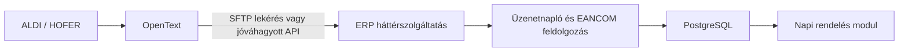

# OpenText Task 1 és a Napi rendelés modul kapcsolattípusa

Dátum: 2026-10-12.

**Későbbi pontosítás a Task 2 dokumentumai alapján:** a lépésenkénti útmutató 15. oldala a Task 5-nél AS2, VAN, X400 és SFTP kapcsolatot sorol fel, az SFTP-t a beszállító kezdeményezi. Az SFTP javaslatnak így már van projektspecifikus dokumentált alapja; a technikai adatokat a Task 6-ban kell egyeztetni. Task 3 jóváhagyás és további feladatok: [részletes útmutató](opentext-task3-edi-megallapodas-20261012.md).

## Megállapítás a képernyőképek alapján

A következő fájlok egy-egy oldala a Task 1 űrlap részeit mutatja. A feladat neve: **Task 1 - Confirmation of Supplier Information**.

- `ALDI opentext/OpenText Trading Grid Intelligence.pdf`: feladatnév és cégadatok.
- `ALDI opentext/OpenText Trading Grid Intelligence 2.pdf`: EANCOM / Classic EDI besorolás, megerősítés és megjegyzésmező.
- `ALDI opentext/OpenText Trading Grid Intelligence 3.pdf`: technikai kapcsolattartó adatai.
- `ALDI opentext/OpenText Trading Grid Intelligence 4.pdf`: külön portálfelhasználó igénylése.

A következő lépés ennek a portálfeladatnak a kitöltése. A korábbi e-mail-tervezet kiegészítő technikai egyeztetéshez használható; a Task 1 elvégzését nem helyettesíti.

Portál: https://visibility.inovis.com/dataquality/xclient/aldibp

A portál nyilvános megnyitásából nem volt olvasható feladatlista. Az alábbi mezőnevek és értékek a négy helyi PDF szövegének és renderelt képének ellenőrzésén alapulnak. Bejelentkezés, űrlapkitöltés vagy beküldés nem történt. A későbbi feladatok nevét és számát a képek nem mutatják.

## Javasolt integráció

| Réteg | Javaslat |
| --- | --- |
| Üzenetszabvány | EANCOM, az ALDI SOUTH Group ORDERS 2.4 AHEAD útmutatója szerint, EDIFACT D.01B |
| EDI megoldás | Classic EDI; saját ERP-ben megvalósítandó automatikus integráció |
| Átviteli mód | Első műszaki javaslat: SFTP kliens, automatikus lekéréssel az OpenText által biztosított végpontról, ha ezt a partnerhez engedélyezik |
| API lehetőség | Ha ehhez a partnerkapcsolathoz dokumentált, eredeti ORDERS üzeneteket átadó API érhető el, azon is megvalósítható az automatikus fogadás |
| Feldolgozás helye | ERP háttérszolgáltatás; tartós fogadás és feldolgozás PostgreSQL-be |
| Felhasználói működés | A Napi rendelés modul a már feldolgozott adatbázis-adatokat jeleníti meg |

Az SFTP javaslat a jelenlegi, dokumentumokat feldolgozó Node.js ERP és az automatikus lekérési cél alapján született. Kimenő klienskapcsolattal megvalósítható az üzenetek időzített átvétele; a lehívási gyakoriságot az OpenText korlátaival és az üzleti igénnyel kell egyeztetni. A jelenlegi kódban SFTP, AS2 vagy OpenText API fogadási adaptert nem találtunk, ezért bármelyik választott átviteli módhoz fejlesztés szükséges.

A Task 1-ben látható **Classic EDI nem átviteli protokoll**. Az EANCOM/Classic EDI választás mellett API-s vagy SFTP-s fogadás is elképzelhető, a szolgáltató feltételeitől függően. A képernyőkép nem igazolja az SFTP vagy az API rendelkezésre állását, és nem mutat hozzájuk választómezőt.

Az OpenText nyilvános [B2B Integration Foundation](https://www.opentext.com/products/b2b-integration-foundation) oldala általánosan felsorolja az AS2, SFTP, FTPS, HTTPS és API lehetőségeket. Ez a konkrét `1060776-AT-2` partnerkapcsolat engedélyezett lehetőségeit nem bizonyítja. A Task 1 után megjelenő kapcsolati feladatban, vagy a portál által biztosított technikai egyeztetésben kell ezt véglegesíteni.

## Task 1 mezőnként

| Képen látható mező | Kitöltés / ellenőrzés |
| --- | --- |
| Business Partner Name | GAVA-HUNGRIA KFT. |
| Business Partner Type | Supplier |
| Business Partner Number | 1060776-AT-2 |
| Business Partner EDI Message Standard | EANCOM – megfelel a tervezett ORDERS integrációnak |
| Business Partner EDI Solution | Classic EDI – megfelel a tervezett saját ERP integrációnak |
| EDI Contact Name | A kapcsolat kiépítéséért és teszteléséért felelős tényleges személy neve |
| EDI Contact E-Mail | A technikai kapcsolattartó tényleges e-mail-címe |
| EDI Contact Telephone | A technikai kapcsolattartó telefonszáma, országkóddal |
| EDI Provider (if applicable) | Külső EDI szolgáltató esetén annak neve; saját integrációnál üresen hagyható, ha a portál engedi |
| Additional user log on | No new user required, ha ugyanaz a már hozzáféréssel rendelkező személy a technikai kapcsolattartó; külön személynek Yes please add the new user, ha hozzáférésre van szüksége |

Az EDI Provider mezőbe az OpenText nevét nem kell automatikusan beírni pusztán azért, mert ők kezelik az ALDI onboardingot. A mező a vállalat oldalán a kapcsolódásért/tesztelésért felelős külső szolgáltatót kérdezi.

### Az adatok helyességének megerősítése

Az űrlap **Yes the provided information is correct** / **No the provided information is incorrect** választást kér.

Az EANCOM és Classic EDI a tervezett megoldásnak megfelel. Ha a Task 1 ezeket az új onboardinghoz rögzített céladatként kéri visszaigazolni, és a cégadatok helyesek, a Yes válasz indokolt.

Ugyanakkor a jelenlegi ERP kézi PDF importot használ; működő EANCOM adatkapcsolatot még nem igazoltunk. Ha a portál a már működő kommunikációt kérdezi, vagy a Classic EDI besorolást kész működési képességként értelmezi, ezt No válasszal és magyarázattal kell pontosítani. A képernyőkép önmagában nem dönti el ezt az értelmezést.

A megjegyzésmező látható, és az űrlap kifejezetten az eltérő adatok magyarázatára nevezi meg. Nem szabad kizárólag egy technikai kérés beírásáért helytelennek jelölni egy egyébként helyes adatot. Ha Yes mellett a mező nem használható, az alábbi technikai szöveg a megfelelő későbbi portálfeladatban vagy egyeztetésben használható.

### Beilleszthető technikai szöveg

> The company details are correct. EANCOM / Classic EDI is our intended integration solution. Our current ERP imports purchase-order PDFs manually; automated EDI connectivity is not yet implemented. We intend to receive and process ALDI SOUTH Group ORDERS 2.4 AHEAD messages automatically in our own ERP, including new orders, order amendments, line-item deletions and complete cancellations. Our proposed transport is automated retrieval via an OpenText-hosted SFTP connection, subject to availability and approval for partner 1060776-AT-2. If an API delivering the original ORDERS payloads is supported for this connection, please provide the corresponding specification and access requirements. Please advise the appropriate connectivity task, test and production connection details, and whether our order changes will use delta or full-load messages. The solution will require implementation and end-to-end testing before go-live.

### Beilleszthető pontosítás, ha a meglévő működést kell igazolni

> The company details are correct, but the EDI solution must be clarified: our current ERP uses manual PDF order import and does not yet have an operational EANCOM connection. EANCOM / Classic EDI is our intended target solution for this onboarding. We plan to implement automated reception and processing of ORDERS 2.4 AHEAD messages, including amendments and deletions. Please confirm the supported connectivity options and the next task for establishing this connection.

Az űrlapot a kötelező mezők kitöltése után kell menteni és a portál elérhető véglegesítési műveletével befejezni. A képeken a gomb felirata csonkolt (`Save & Ope...`); ebből a feladat lezárásának pontos gombneve és működése nem állapítható meg. Mentés után a feladat állapotát és a következő kiosztott feladatot ellenőrizni kell.

## ERP feldolgozási elvárások

Tervezett adatút:

A kapcsolat csak az üzenetet szállítja; az ERP adapter végzi az üzleti feldolgozást. A jelenlegi PDF végpontot nem elég automatikusan meghívni EDIFACT fájllal.

- BGM 220/230: új rendelés és rendelésmódosítás, a partnerhez érvényes ORDERS útmutató szerint.
- LIN 1/2/3/4: hozzáadás, törlés, módosítás és változatlan sor.
- Delta módosításból hiányzó sor megmarad. Full-load és delta értelmezését a fogadási szerződésben rögzíteni kell.
- Külső rendelés-, verzió- és tételazonosítók megőrzése; ismétlések és sorrenden kívüli üzenetek kezelése.
- GTIN és csomagolási egység ellenőrzött megfeleltetése az ERP termékeihez és kartonmennyiségéhez.
- A már teljesített mennyiségek és részszállítások kezelése; QTY 27 nem azonos teljes tételtörléssel.
- Az eredeti üzenet tartós mentése, feldolgozási állapot, hibajelzés és újrapróbálás.
- Az átvételi visszajelzés és az üzleti feldolgozás sikere külön kezelendő; az átvett üzenet ne vesszen el feldolgozási hibánál.
- A táblázat megnyitása PostgreSQL adatokat olvasson, és ne várjon külső adatkapcsolatra.

Ez a jegyzet kapcsolattípus-javaslat és kitöltési útmutató. Éles kapcsolatot, automatikus lehívást vagy ORDERS parser implementációt nem hoztunk létre.
